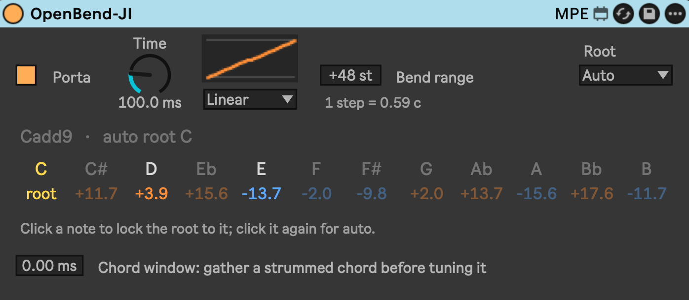

# OpenBend JI



A Max for Live version of [OpenBend](https://github.com/Licensed-Driver/OpenBend) by Licensed-Driver.

It retunes the chords you play to 5-limit just intonation and follows the root as the harmony moves. Each note goes out on its own MPE channel with its own pitch bend.

## Use

Needs Live 12 with Max 9, and an MPE synth after it with a ±48 semitone bend range. Drift and Wavetable work as they are.

Download `OpenBend-JI.amxd` from Releases and drop it into your User Library under `Presets/MIDI Effects/Max MIDI Effect/`, then put it in front of the synth.

## Build

`build_amxd.py` (Python 3.12+) writes the device into your User Library. `test_engine.js` tests the engine without Live.

```bash
python3 build_amxd.py
```

```bash
node test_engine.js
```

## License

GPLv3, like OpenBend.
